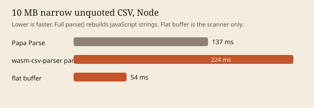

# wasm-csv-parser

A Papa Parse-compatible CSV parser. The scanner is Rust, compiled to WebAssembly. Header rows, dynamic typing, and `skipEmptyLines` stay in TypeScript so `parseFloat` and `Date` match JavaScript.

```ts
import { init, parse, parseAsync } from "wasm-csv-parser";

await init();
const rows = parse(csv, { header: true, dynamicTyping: true });
const big = await parseAsync(file, { header: true, worker: true });
```

React:

```tsx
import { usePapaWasm } from "wasm-csv-parser/react";

const { parse, data, progress, status, abort } = usePapaWasm({ header: true });
```

The demo app is in `examples/react-demo`. It runs the parse in a worker and times the same file against Papa Parse. The hosted build is [themagiche.github.io/wasm-csv-parser](https://themagiche.github.io/wasm-csv-parser/).

## Migrate from Papa Parse

```ts
import Papa from "papaparse";
const result = Papa.parse(csv, { header: true });
```

becomes

```ts
import { parse } from "wasm-csv-parser";
const result = parse(csv, { header: true });
```

`parseAsync` is the path for `File` / `Blob` and for `worker: true`.

## Differences from Papa Parse

- `parse()` is synchronous. `worker: true` throws and tells you to call `parseAsync`. Papa starts the worker and returns `undefined`.
- In the browser, call `await init()` before `parse()`. `parseAsync()` loads the module itself. Node initializes synchronously on the first `parse()`.
- No `unparse`, no `download: true`, and no jQuery build.
- `delimitersToGuess`, `skipFirstNLines`, `beforeFirstChunk`, and network options throw `Unsupported Papa Parse option: …` instead of being ignored.
- Default stream chunk size is 8 MiB.
- `transform` runs in JavaScript on every cell. Leave it off for large files.

Anything else in the v1 config table matches Papa Parse 5.7, including errors and `meta`. The differential tests compare `parse()` with `papaparse@5.7.0`.

## Speed

On string input, `parse()` is often slower than Papa Parse at 1–10 MB. Papa splits the JavaScript string it already has. `parse()` encodes that string to UTF-8, scans it in wasm, then builds JavaScript strings again. The scan itself is faster. On a 10 MB narrow unquoted file the flat buffer returned in 54 ms and Papa Parse took 137 ms, while the full `parse()` call took 224 ms.

A second wasm export that built `string[][]` with `js_sys` was slower on every case (258 ms vs 54 ms on that same file) and was removed. ASCII fields are one `TextDecoder` string plus slices.



Full table, including the cases that lose: [`packages/bench/RESULTS.md`](packages/bench/RESULTS.md). 100 MB and 500 MB were not measured in this environment. Generate them with `pnpm bench` after raising the sizes in `packages/bench/src/run.mjs`.

Current release build: 53,321 bytes raw, 24,049 gzip, 20,612 brotli. `pnpm --filter wasm-csv-parser size` prints the same check and fails if gzip reaches 100 KB.

## Layout

- `crates/csv-engine` — Rust scanner, no JavaScript dependency. Hand-written, not `csv-core`, because Papa's quote recovery and fast-mode preview cursor are not RFC 4180.
- `packages/wasm-csv-parser` — TypeScript package. Exports `.`, `./react`, `./worker`, and `./wasm-csv-parser_bg.wasm`.
- `packages/bench` — Node timings against Papa Parse.
- `examples/react-demo` — file drop, progress, and a timing comparison.
- `fixtures` — small CSV files. Large benchmark files are generated, not committed.

## Develop

Rust stable, Node 22, and pnpm 10.

```sh
cargo test
pnpm install
pnpm --filter wasm-csv-parser build
pnpm --filter wasm-csv-parser test
pnpm --filter react-demo dev
```

The demo listens on [http://127.0.0.1:43123](http://127.0.0.1:43123).

`cargo fuzz` is set up under `crates/csv-engine/fuzz` and excluded from the workspace. It needs a nightly toolchain and `cargo-fuzz`.

## Publish

Versions are tracked with Changesets. This repo does not publish on its own. After `npx changeset` and `npx changeset version`, publish with `npm publish -w wasm-csv-parser` from a machine that has an npm token. The wasm binary is produced by `pnpm --filter wasm-csv-parser build` and is part of the package (`pkg/wasm-csv-parser_bg.wasm`).
